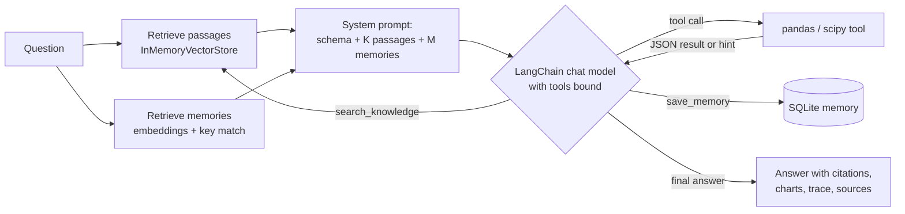

# Agentic RAG: a data-analysis agent with retrieval and memory

Agentic RAG answers plain-English questions about any CSV or Excel table. It is a rebuild of
Agentic Task on **LangChain**, with **retrieval-augmented generation (RAG)** and a new flat 2D web interface.

* The language model plans the analysis, but every number comes from one of nine analysis tools
  that run real pandas and SciPy code on the full table.
* Before answering, the agent **retrieves** passages from a knowledge base (glossaries and data dictionaries
  you upload, plus a card for each column of the current dataset) and the facts you've taught it. Passages
  are labelled `[K1]`, `[K2]` and so on, and the answer cites them inline.
* The interface shows each citation as a highlighter mark. Click one to light up the passage it came from,
  next to the full tool trace.

## Quick start (Windows)

Double-click `run.bat`. It creates `.venv` and installs requirements the first time, then opens
http://localhost:8501.

Or by hand:

```bash
python -m venv .venv
.venv\Scripts\activate            # macOS/Linux: source .venv/bin/activate
pip install -r requirements.txt
python -m agentic_rag              # http://localhost:8501
python -m pytest                   # 36 tests, no API key or network needed
```

The first start downloads a small local embedding model (BAAI/bge-small-en-v1.5, about 70 MB) into
`store/models`. If that fails, retrieval falls back to keyword hashing and the sidebar says so.

### Choosing a model

Pick a provider in the sidebar under **Model** and paste a key, or set it in `.env` (see `.env.example`).

| Provider | LangChain class | Default model | Key |
|---|---|---|---|
| `anthropic` | `ChatAnthropic` | `claude-opus-5-5` (adaptive thinking, server-side refusal fallback) | `ANTHROPIC_API_KEY` |
| `groq` | `ChatOpenAI` on Groq's endpoint | `llama-3.3-70b-versatile` | `GROQ_API_KEY` |
| `ollama` | `ChatOpenAI` on Ollama's endpoint | `qwen2.5:7b` | none, runs locally |
| `openai` | `ChatOpenAI` | `gpt-4o-mini` | `OPENAI_API_KEY` |
| `offline` | a rule-based `BaseChatModel` | none | none |

Offline mode is for trying the app with no key. It understands simple phrasings only and labels its answers.

## How it works



1. **Index.** Uploaded documents are split with LangChain's `MarkdownHeaderTextSplitter` (one glossary
   entry per chunk) and `RecursiveCharacterTextSplitter`. Every loaded dataset gets column cards (type, range,
   example values). Chunks are embedded into a LangChain `InMemoryVectorStore`. Their text and metadata live
   in SQLite (`store/knowledge.db`), so the index is rebuilt on restart.
2. **Retrieve.** Hybrid search: vector similarity re-ranked with a small keyword-overlap bonus. Column cards
   are only searched for the current dataset. Passages below a relevance floor are dropped, so the model isn't
   handed noise.
3. **Generate.** The chat model (`bind_tools`) sees the schema, the retrieved passages and the relevant
   memories. It calls tools, reads results as `ToolMessage`s and retries after errors. It can also call
   `search_knowledge` mid-answer (agentic RAG) when a term isn't covered.
4. **Answer.** Events stream to the browser as NDJSON: retrieval, each tool call, then the answer with its
   citations (only labels that were actually retrieved count), charts, the trace and the sources.

## The tools

Nine analysis tools, plus `search_knowledge`, `save_memory` and `forget_memory`. They are LangChain
`StructuredTool`s with pydantic argument schemas, so malformed calls are rejected before they run.

| Tool | What it does |
|---|---|
| `dataset_overview` | Types, missing values, unique counts, summary statistics, top categories |
| `filter_rows` | Structured row conditions, sorting, limits |
| `group_aggregate` | Group-by with sum/mean/median/min/max/count/nunique/std, top-N and % share |
| `time_series` | Daily to yearly resampling, % change, trend, peak, incomplete-period warning |
| `correlation` | Pearson/Spearman/Kendall pairs, or the drivers of one target |
| `detect_outliers` | IQR or z-score, most extreme rows |
| `compare_groups` | Welch t-test, Mann-Whitney U and Cohen's d; chi-square for categories |
| `derive_column` | Safe arithmetic expressions (no function calls, no dunder access) |
| `create_chart` | Bar, line, histogram, scatter or share chart, returned as data and drawn as SVG |

Filters are structured JSON (`{"column": "status", "op": "!=", "value": "cancelled"}`), never generated code.

## Memory

Memory is a curated store of typed facts (definitions, named filters, preferences, corrections, column notes),
not a chat log. It is kept in SQLite (`store/memory.db`) and retrieved by meaning:

* **Write policy.** Content over 600 characters is rejected, preferences are validated, and a filter is
  checked against the real data before it's saved.
* **Versioning.** Saving a new value for a key supersedes the old one; history and an audit log are kept.
* **Conflicts.** A fact the user stated can't be overwritten by something the agent inferred. The agent
  gets a `conflict` and must ask.
* **Scope.** Preferences are global. Definitions belong to their dataset but carry over to a file with the
  same columns. Memories whose columns are missing are shown as stale and not applied.
* **Control.** The Memory view lists, edits, deletes, shows history, exports and clears.

## Demo walkthrough

1. Pick **subscriptions** and ask "What does churn rate mean here?" The definition is retrieved from the
   glossary and cited.
2. "Which plan has the highest churn, and is the difference significant?" runs a chi-square test.
3. "Active customers excludes cancelled accounts. Remember that." saves a definition with a filter.
4. "How many active customers per region?" applies the remembered filter. The evidence panel shows the
   memory as applied.
5. Upload your own glossary under **Knowledge** and use **Test retrieval** to see what comes back.
6. Switch to **retail_sales** and ask "What's the revenue trend by quarter?" The festive-season definition
   explains the Q4 peak.

## Project layout

```
agentic_rag/
  data.py        loading, type inference, schema text, dataset fingerprint
  embeddings.py  local bge-small embeddings (fastembed) and a hashing fallback, as LangChain Embeddings
  knowledge.py   knowledge base: splitting, column cards, vector store, hybrid search
  memory.py      SQLite memory with versioning, conflicts, scope and semantic retrieval
  analysis.py    the analysis functions (pandas / scipy)
  tools.py       LangChain StructuredTools with pydantic schemas
  llm.py         chat model factory and the offline model
  agent.py       the RAG agent loop
  server.py      FastAPI backend
web/             the 2D interface (HTML, CSS, JS; no build step)
knowledge/       documents indexed on first start (a sample business glossary)
data/            sample datasets (scripts/make_sample_data.py regenerates them)
tests/           36 tests: retrieval, memory, tools, agent loop, API
```

## Limitations and next steps

* The vector store is in memory and rebuilt at startup. That's fine for hundreds of chunks; use Chroma
  or pgvector for large document sets.
* One table at a time; no joins.
* The relevance floor is a fixed threshold per embedding model. A cross-encoder re-ranker would be more robust.
* Offline mode understands only simple phrasings.
